# MVS Classic

A fan-made port of the 2023 MultiVersus open beta, rewritten from scratch as one native Windows program in Rust.
It plays like the beta did: the same characters, moves, stages and menus, read from your own copy of the beta.
It doesn't include any of the game's files.

<p>
  <a href="https://github.com/Toxcious/mvs-classic/releases/latest"></a>
</p>

> [!IMPORTANT]
> MVS Classic contains nothing from the original game. To play, you need your own copy of the 2023 MultiVersus
> open beta, which the launcher builds the game from. The [install guide](#install) shows how to download it.

## Contents

- [What's in it](#whats-in-it)
- [Screenshots](#screenshots)
- [What you need](#what-you-need)
- [Install](#install)
- [Online](#online)
  - [How it works](#how-it-works)
  - [Host your own relay](#host-your-own-relay)
- [Notes](#notes)
- [For developers](#for-developers)
  - [Build from source](#build-from-source)
  - [Check a change](#check-a-change)
  - [Make your own fork](#make-your-own-fork)
- [Disclaimer](#disclaimer)
- [Licence](#licence)

## What's in it

- The open beta's roster, stages and match rules, with the beta's numbers and timings
- Local matches against friends or bots, the Lab, and the tutorials
- Online play with rollback netcode: quick play, custom lobbies and parties
- The beta's menus, HUD, effects and sound, drawn with Direct3D 11
- Built to run well on a wide range of PCs. The game keeps the beta's fixed 60 Hz tick rate, while the frame rate is
  uncapped and frames between ticks are interpolated, so high refresh rate displays get smooth motion

### Added by the port

The port also has a few features of its own. None of them change the characters or how a standard match plays.

- **Lab Tools.** A training panel in the Lab, opened with F1 or the right stick button. It shows collision shapes,
  projectiles, stage bounds and each character's current state, and changes the game speed. It can also set or lock
  a character's damage, make it invulnerable, give it unlimited air moves or hold it in place, and hide the HUD or
  visual effects.
- **Experimental settings.** Optional rules for custom lobbies, off by default and set by the lobby leader for
  everyone in it. Stock Mode gives each player a number of lives, and the last player or team with lives left wins.
  Mutators apply one of the beta's own mutators, such as Big Head or Low Gravity, to the whole match.
- **Text chat.** Messages in custom lobbies and online matches, sent to your team or to everyone.
- **Social.** A list of players who are online, invites, parties, and join links and short codes for
  custom lobbies.

## Screenshots

<p>
  <a href="docs/images/main-menu.jpg">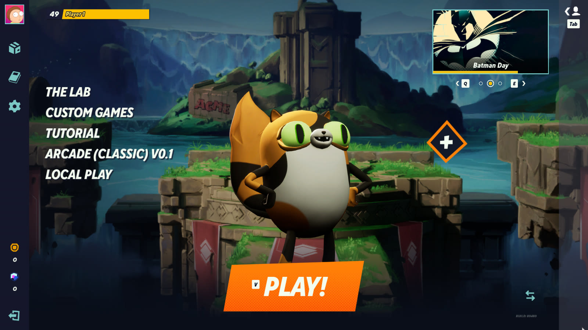</a>
  <a href="docs/images/custom-games.jpg">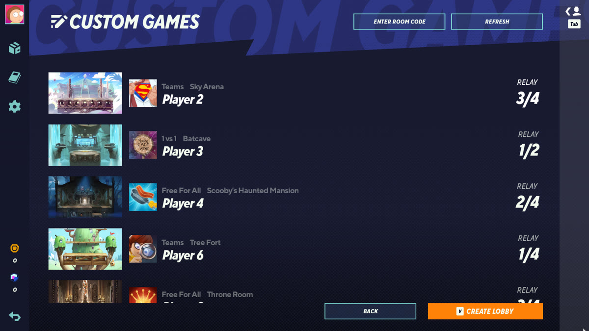</a>
</p>

<p>
  <a href="docs/images/pre-match.jpg">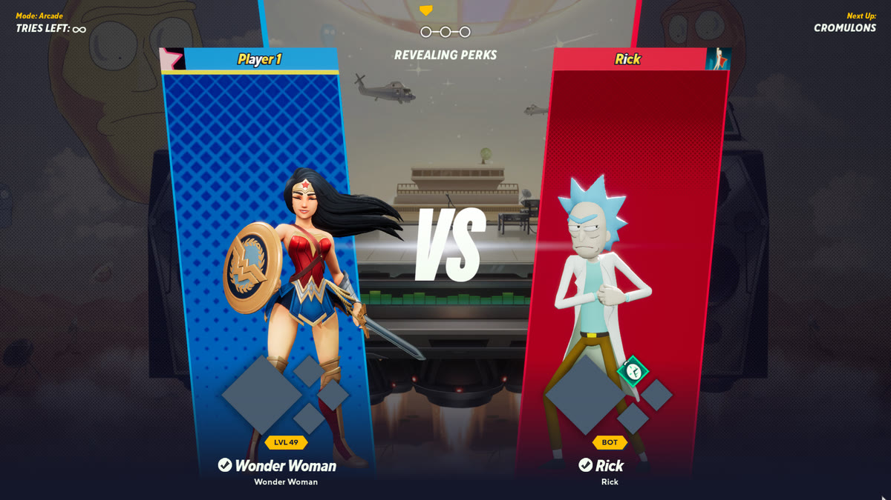</a>
  <a href="docs/images/arcade.jpg">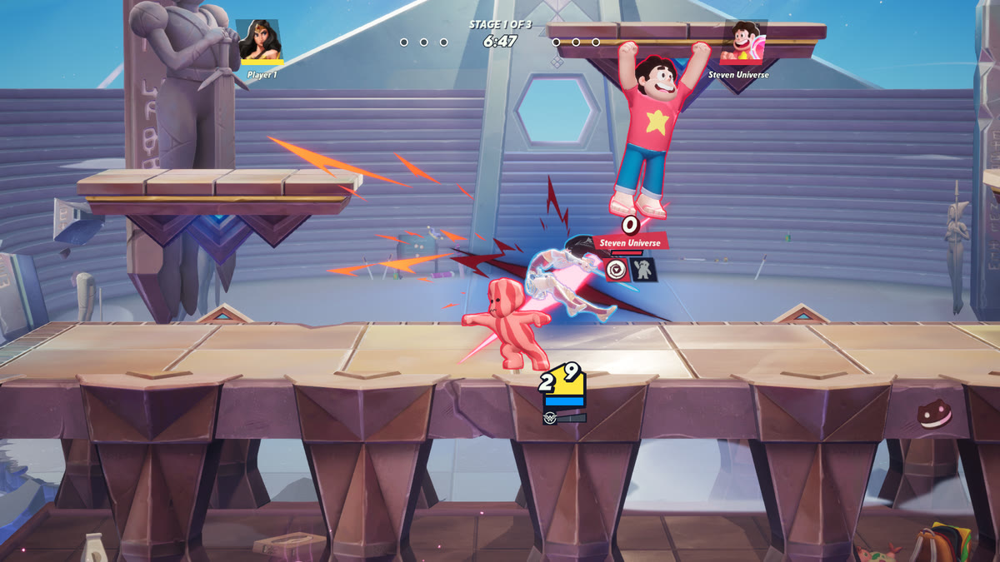</a>
  <a href="docs/images/character-select.jpg">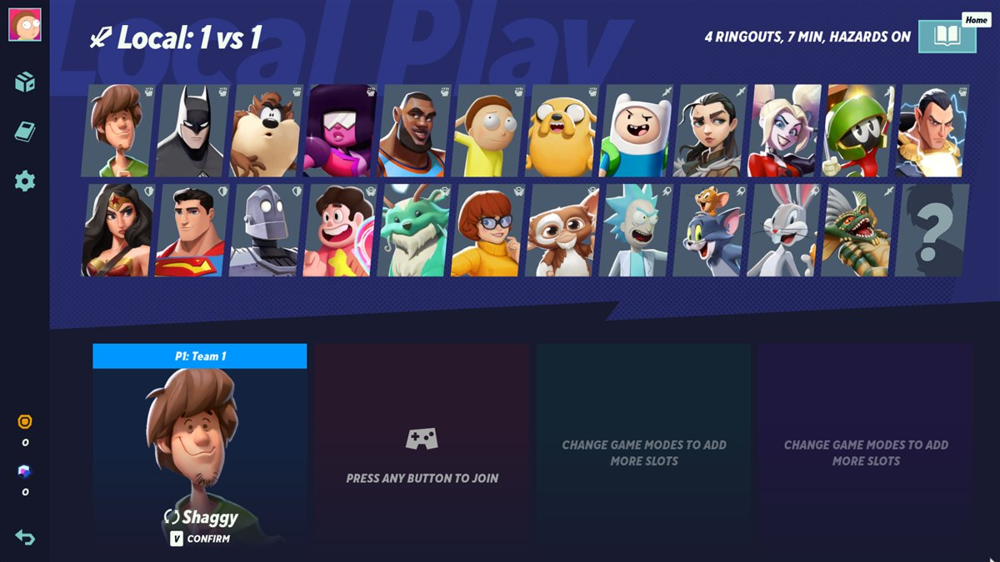</a>
  <a href="docs/images/podium.jpg">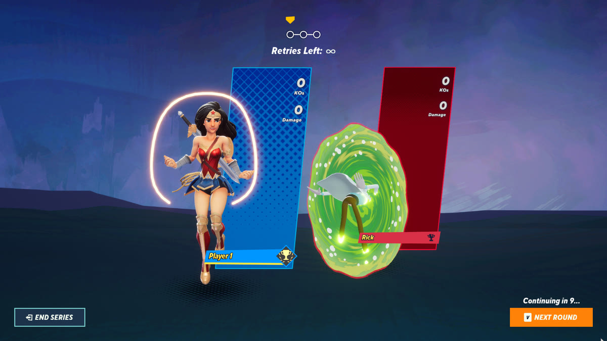</a>
</p>
<p>
  <a href="docs/images/lab.jpg">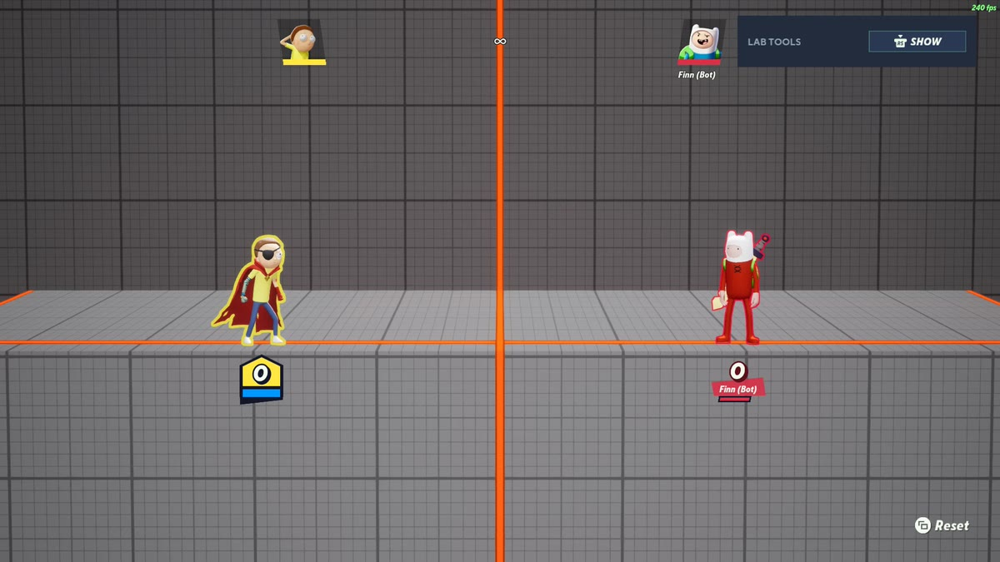</a>
  <a href="docs/images/lab-display.jpg">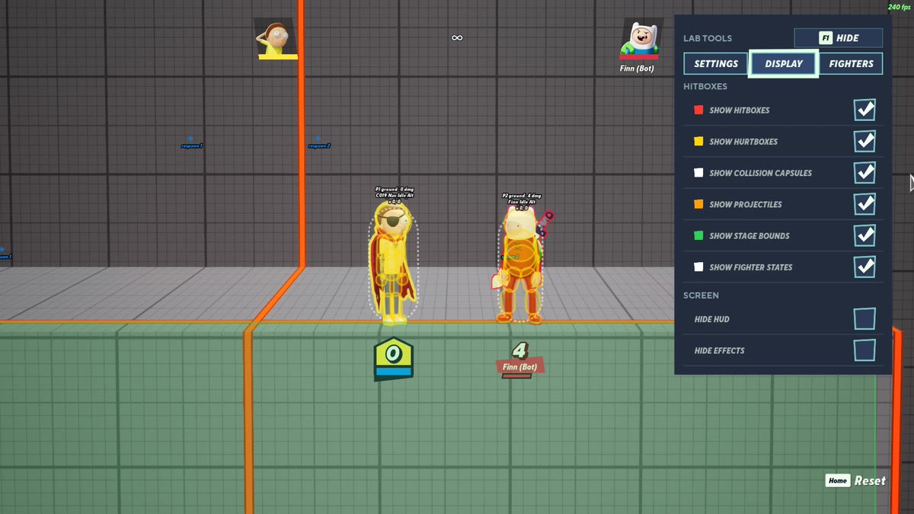</a>
  <a href="docs/images/lab-settings.jpg">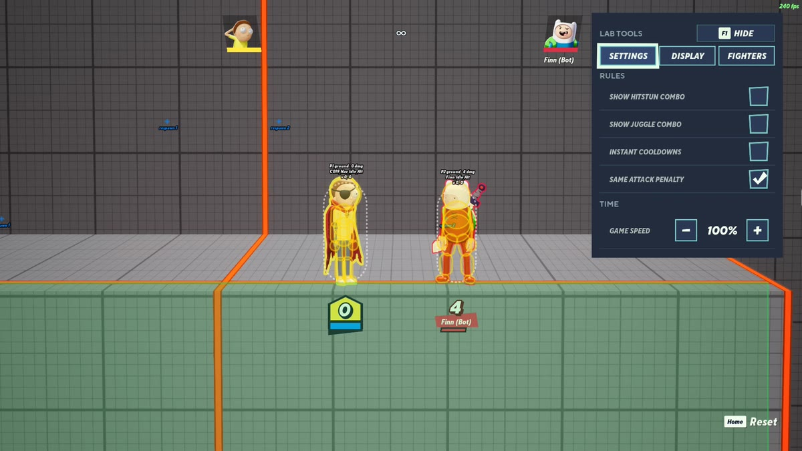</a>
  <a href="docs/images/lab-fighters.jpg">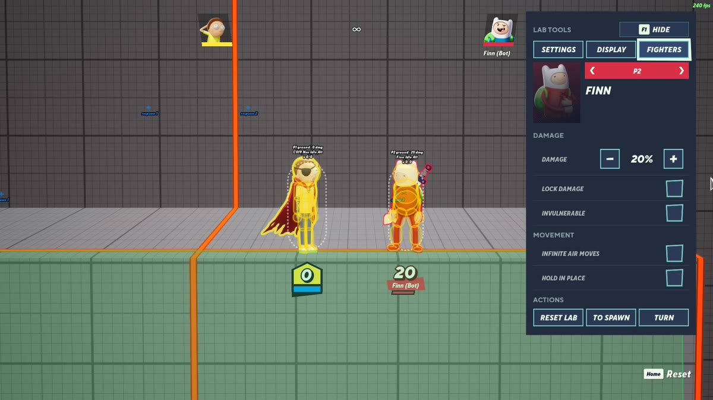</a>
</p>
<p>
  <a href="docs/images/custom-lobby.jpg">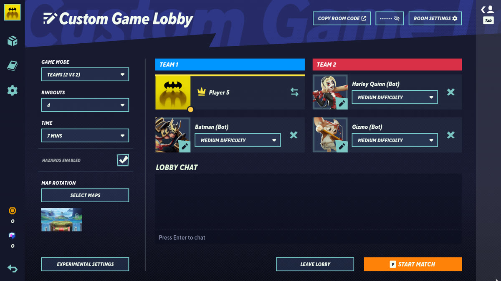</a>
  <a href="docs/images/launcher.jpg">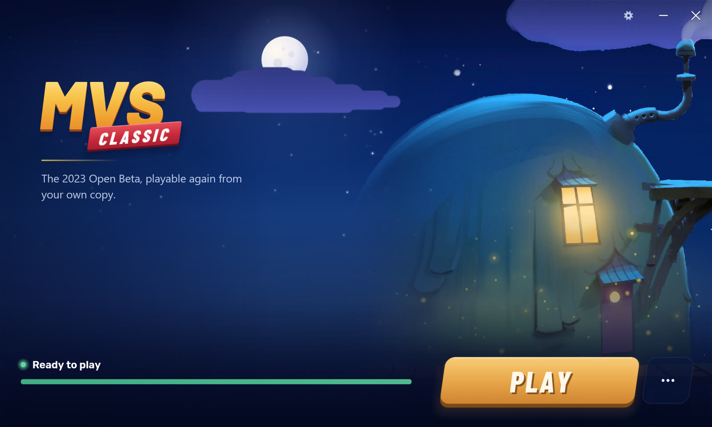</a>
  <a href="docs/images/launcher-setup.jpg">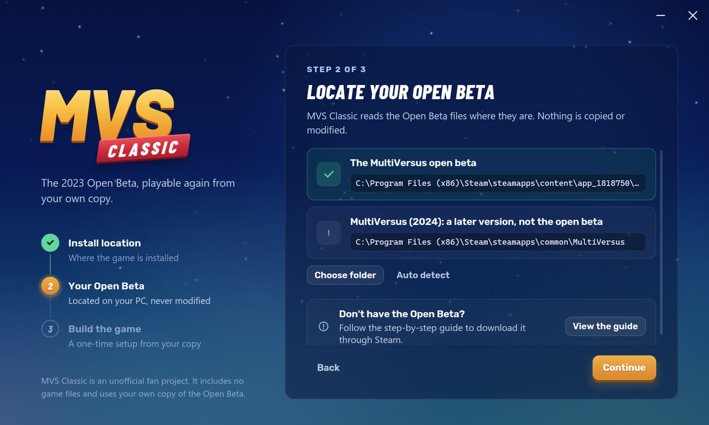</a>
  <a href="docs/images/launcher-build.jpg">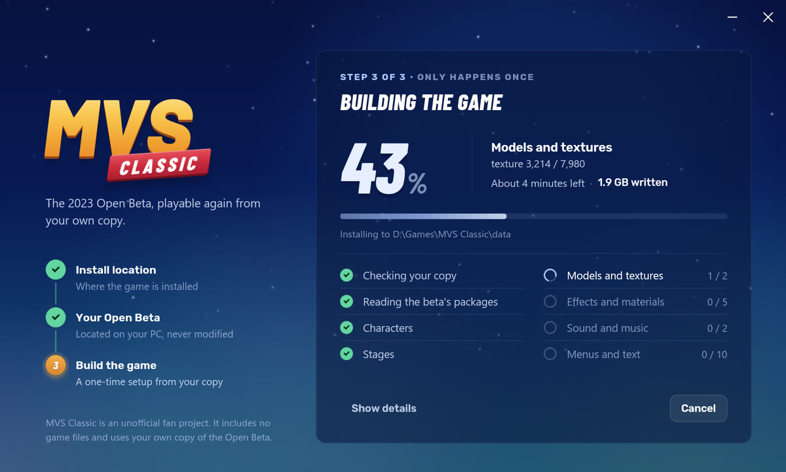</a>
</p>

## What you need

- **Windows 10 or 11, 64-bit**, with a graphics card that supports Direct3D 11
- **MultiVersus in your Steam library.** The open beta is downloaded through Steam, which only works for accounts
  that have MultiVersus.
- **About 16 GB of disk space:** about 8 GB for the open beta and 8 GB for the game the launcher builds from it

## Install

1. **Download MVS Classic.** Download the zip from the
   [latest release](https://github.com/Toxcious/mvs-classic/releases/latest) and unzip it into the folder where you want
   the game.
2. **Download the open beta.** It's still on Steam and is downloaded through the Steam console, about 8 GB. The
   launcher shows these steps too.
   1. Start Steam and sign in.
   2. Open the Steam console: enter `steam://open/console` in your browser's address bar or in the Windows Run
      dialog.
   3. Paste this into the console and press Enter:

      ```
      download_depot 1818750 1818751 8780239795816477473
      ```

   4. Wait for the message "Depot download complete", which names the folder it was saved to. The console shows no
      progress while it downloads.
3. **Set up the game.** Run `MVSC Launcher.exe` and follow its three steps:
   1. Choose where to install the game.
   2. Locate your open beta: press **Auto detect**, or **Choose folder** and pick the `depot_1818751` folder Steam
      created.
   3. Build the game. The launcher builds it from your copy of the beta. This happens once and needs about 8 GB of
      free space. Your copy of the beta is only read, never changed.
4. **Play.** Press Play in the launcher. Each time it opens, it checks this repository's releases for a newer
   version and offers to update.

## Online

### How it works

Online matches use rollback netcode. Each player's game runs the whole match and only the players' inputs are sent.
When an input arrives late, the game rewinds to that moment and replays the match with it, so a match never stops to
wait for a slow connection.

Players find each other through a relay server. It hosts custom lobbies, parties, invites and the quick play queue,
and passes a match's inputs between the players. It runs no game rules and holds no game files, and players never
see each other's IP addresses. By default the game uses a relay hosted for the project in Europe.

The launcher's Settings > Online has the other ways to connect:

- **Relay server:** the address of another relay, such as one a friend or a community runs.
- **Epic Online Services:** custom games and party invites through Epic, and matchmaking when no relay is
  available.
- **Local network (LAN):** host and join custom games with players on the same network.
- **Direct connections:** connect straight to friends in a custom game when both networks allow it. This can lower
  the lag. It's off by default.

### Host your own relay

Anyone can run a relay, on a PC at home or on a rented server:

1. Download the relay's zip from the same release: `mvs-relay.exe` for Windows and `mvs-relay` for Linux (x64).
2. Put it in a folder of its own and start it. On its first start it writes its config and its own key beside it;
   keep a backup of the key.
3. Open port 7777 for TCP and UDP: forward it on your router for a home PC, or open it in the server's firewall.
4. Give players the address. They enter it in the launcher under Settings > Online > Relay server, for example
   `relay.example.org` or `203.0.113.5:7777`.

Whoever runs a relay can read the traffic that passes through it and sees the addresses of the players who connect.
[docs/relay.md](docs/relay.md) has the full guide: running it as a Linux service, the config, backing up the key and
what players' games check.

## Notes

MVS Classic started out as a browser game written in TypeScript with three.js, later wrapped in Electron as a
desktop app. It got the matches playing, but a browser holds a game like this back: it ran heavier than it should,
the beta's own shaders had to be translated for WebGL, and the whole thing sat on a stack of web tools. So it was rewritten
as one native Rust program, piece by piece, with its own Direct3D 11 renderer, to run well across a wide range
of hardware, lower-end PCs included.

The TypeScript version is not published. While porting, it served as the reference: the Rust sim was checked
against its recorded matches tick by tick until they matched exactly. That's what code comments mean when they
mention "the TS" or "the oracle". [crates/README.md](crates/README.md) has more.

## For developers

Everything is one Cargo workspace in [`crates/`](crates/README.md): the game, the launcher and importer, the
renderer, the UI, audio, the online code and the relay. Where to read first:

- [docs/development.md](docs/development.md): building, importing your beta into a dev store, running and checking
  a change
- [crates/README.md](crates/README.md): what each crate does and the rules the match code follows
- [AGENTS.md](AGENTS.md): the rules for any change, by hand or with an AI agent
- [docs/code-style.md](docs/code-style.md): how code and comments are written
- [docs/experimental.md](docs/experimental.md): the opt-in custom lobby rules, the place for rules of your own

### Build from source

You need Rust (stable) and the Visual Studio C++ build tools.

```
cargo build --release -p mvs-app
```

This builds `target\release\mvs-launcher.exe`, the launcher that builds the game from your copy of the beta, and
`target\release\mvs.exe`, the game. A release names them `MVSC Launcher.exe` and `game\MVS Classic.exe`.
For day-to-day work, `play.bat` builds both and opens the launcher on your dev store.

### Check a change

- `cargo fmt --check` and `cargo clippy --release --all-targets` with no new warning, and the tests of the crates
  you touched.
- The match is deterministic: the same inputs give the same match on every machine, which rollback relies on. Match
  code does its math through `mvs-math`, with no platform float routines, no std `HashMap` and no `unsafe`.
- A change to the match code is checked with `sim-trace`, which records matches from your own store and replays them
  tick by tick. A change not meant to change how a match plays leaves every match `same`.

### Make your own fork

- **Never commit the game's files.** Assets, data tables, decoded dumps, text and keys from the beta stay out of the
  repo; players bring their own copy and the importer reads it. `content/` is ignored by git for this reason.
- **Updates.** A build checks for updates only when `MVS_UPDATE_FEED` is set at build time, to the GitHub API
  address of a repository's latest release (`https://api.github.com/repos/<owner>/<repo>/releases/latest`). Point
  it at your fork's releases, or leave it unset and the build never checks.
- **Online.** [`online.json`](online.json) holds the relay the game connects to by default and the id of its key.
  Change it to your own relay ([docs/relay.md](docs/relay.md)) if your fork plays differently online, so its
  players don't meet players of this one. Epic Online Services needs credentials of your own; without them it stays
  off and the relay and LAN still work.

## Disclaimer

MVS Classic is not affiliated with or endorsed by Warner Bros. Games or Player First Games. MultiVersus and its
characters are trademarks of their owners.

## Licence

The code is under the [MIT licence](LICENSE). Third-party code keeps its own licence: see the `NOTICE` and `LICENSE`
files in the crates that hold it.
